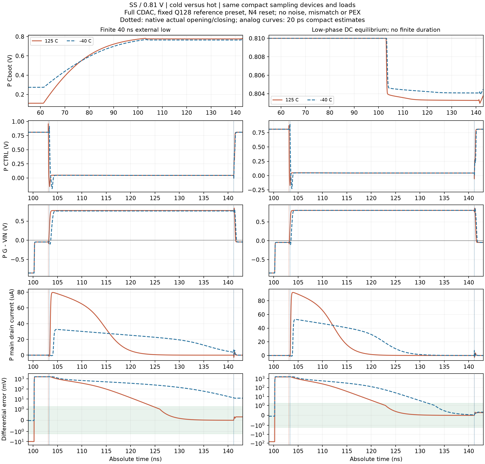

# SS 冷角采样：有限预充与充分预充对照

40 ns 有限预充在冷角仍有**关断前建立不足**；目前不能据此把主要误差归因于关断注入，也不能立即判定必须增大主开关。

| 温度 / 预充历史 | 实际获取窗口 (ns) | 关断前差分误差 (mV) | 关断后净变化 (mV) | 141.8 ns 保持误差 (mV) |
| --- | ---: | ---: | ---: | ---: |
| 125°C / 有限 40 ns | 38.0383 | +0.00154 | +0.30127 | +0.30282 |
| −40°C / 有限 40 ns | 37.8410 | **+13.69339** | −1.48250 | **+12.21089** |
| 125°C / 低相位 DC 平衡 | 38.0380 | +0.00090 | +0.27813 | +0.27903 |
| −40°C / 低相位 DC 平衡 | 37.8376 | +0.05498 | +0.25108 | +0.30605 |

测试：SS MOS、0.81 V、TT 无源；输入差分 +0.81→−0.81 V，100.2–100.3 ns 翻转。保留原有两路 Bootstrap、每侧完整 CDAC、参考最终级和实际采样时钟路径；参考固定 Q128、N4 比较器保持复位。外部电源/时钟理想，输入/参考各 50 Ω、参考去耦各 4 pF；无噪声、失配、PEX。

从上到下为 P 侧 Cboot 电压、CTRL、G−VIN、两只主开关漏电流之和、顶板差分相对输入源的误差。左列有限 40 ns，右列低相位 DC 平衡。虚线竖线是原生数据测得的实际开启/关闭；绿色带为既有 ±0.25 LSB（±1.7578 mV）诊断线。底行采用对称对数坐标。

冷角有限 40 ns 时，开启前 Cboot 仅 0.76931 V，获取中约 0.764 V；DC 平衡对照分别为 0.81000 V 和约 0.804 V。110 ns 时两者 CTRL 都已低、G−VIN 均为正，主开关**已经导通**，但 P 侧主开关总漏电流约 30.19 / 46.64 µA。到关断前，有限预充的 TOPP 仍为 58.709 mV，目标为 45 mV；充分预充对照为 45.028 mV。这支持“预充历史留下的泵压不足，叠加冷角较弱的获取能力”这一定位。

两组冷角实际窗口仅差约 3.44 ps，充分预充对照能建立，说明当前尺寸在该理想边界下具有获取能力。上述电流也受瞬时端压和顶板状态影响，不能直接当作 Ron 比值；现有对照尚未定量分离约 40 mV 泵压缺口的独立贡献。

实际关闭约 141.16471 ns；关断前测量点为各自关闭前 0.2 ns，保持点固定 141.8 ns。表中净变化包含继续建立、馈通及注入，不能单独命名为沟道电荷注入。误差均对比未拟合的输入源差分。

四组均完成且原生日志零错误，冻结输入和收集文件 SHA 已核对；每组 237 MOS 的 1422 组端压检查均为零超限。这只是该隔离夹具的应力筛查，不证明整机 PVT、动态性能或寿命可靠性。原生时间事件与应力使用每个原生点；模拟曲线/电流为 20 ps 紧凑数据插值。有效 CX 设置为 reltol=1e−7、vabstol=10 nV、iabstol=100 fA、maxstep=10 ps、gear2only。

下一项应先验证正常周期约 60 ns 低相位的**有限恢复**：保留同一高相位 DC 初态、101–141 ns 正式采样窗口、输入、负载和尺寸，仅提前第一次下降沿。低相位 DC 平衡不是有限预充时长，也不是真实上电/POR。40 ns 目前不能冻结为全 PVT 启动协议；最短预充时间仍未确定。正常周期还包含转换和参考切换，当前固定参考/复位夹具不能替代其验证。

可复核数据：[results.json](results.json)；生成程序：[review_cold_results.py](../review_cold_results.py)。本次无新仿真、远端操作或电路修改。
