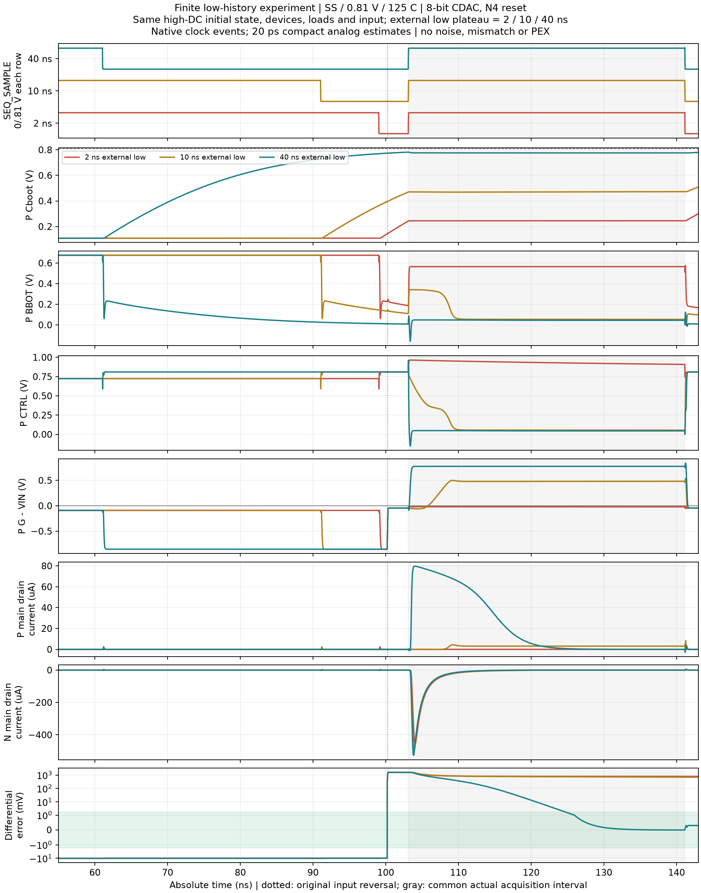

# 有限低相前史：2/10/40ns

三例均完成，初始DC与原0.1ns短组完全一致（所比较的P/N顶板、输入及六个
Bootstrap内部节点最大差值为0）。40ns是本次最小的已测试通过点，**不是
最短预充规格**。没有做器件修改，也没有验证整机转换或真实电源爬升。

测试条件：SS/0.81V/125°C，原输入PWL、100.2–100.3ns输入翻转、50Ω输入、
50Ω/4pF参考网络、完整CDAC与N4复位态负载不变；Q128参考preset固定。
三个输入只提前首次下降沿，正式101ns上升、141ns关闭、100ps边沿均保持。
图中时钟分行显示；灰区是三例实际获取高相的公共区间，虚线是原输入翻转。
电流是两只并联主管的漏端电流之和，正值流入漏端，包含动态电荷成分；
P侧放电为正，N侧充电为负。不能直接将这些瞬态比值当作DC Ron。

## 主要数据

| 外部低平台/ns | 实测SEQ低相/ns | 开启前P侧Cboot/V | 关断前差分误差/mV | 141.8ns误差/mV | 端压超限 |
| ---: | ---: | ---: | ---: | ---: | --- |
| 2 | 4.059936 | 0.242732 | +799.573216 | +800.336675 | 0/1422 |
| 10 | 12.060844 | 0.469808 | +701.789548 | +701.130927 | 0/1422 |
| 40 | 42.061762 | 0.781924 | +0.001543 | **+0.302817** | 0/1422 |

低相按SEQ_SAMPLE实际下降/上升的半电源交越计算，不等于外部平台时长。
开启前Cboot取实际开启前10ps的紧凑插值。误差使用原静态源差模−0.81V；
关断前时点为实际SEQ关闭前0.2ns，保持时点固定141.8ns，不作增益/相位拟合。

| 外部低平台/ns | 实际开启/ns | 实际关闭/ns | 获取窗口/ns |
| ---: | ---: | ---: | ---: |
| 2 | 103.115071 | 141.154908 | 38.039837 |
| 10 | 103.115979 | 141.155132 | 38.039153 |
| 40 | 103.116897 | 141.155152 | 38.038255 |

保持观察均晚于实际关闭约0.645ns。三例获取窗口最大差约1.58ps，没有通过
缩短或移动正式窗口换取结果。底板相对独立固定preset的保持点最大残差
分别为0.02835/0.04878/0.04447mV，远小于本次巨大差分误差。

## 导通期证据

以下统一在110ns、主管仍处于正式获取阶段观察，未用保持后的关断栅压
解释导通能力。电压/电流为20ps紧凑插值，交越和端压筛查使用全部原生点。

| 外部低平台/ns | P BBOT/V | P CTRL/V | P G−VIN/V | P主管电流/µA | N G−VIN/V | N主管电流/µA |
| ---: | ---: | ---: | ---: | ---: | ---: | ---: |
| 2 | 0.565059 | 0.950685 | −0.020194 | −0.000070 | 0.745677 | −16.6874 |
| 10 | 0.059912 | 0.060029 | +0.485198 | +3.4923 | 0.774510 | −14.7071 |
| 40 | 0.048104 | 0.048105 | +0.775528 | +65.0266 | 0.800512 | −12.8567 |

- 2ns：自举储压仍低，P侧BBOT和CTRL没有回到合适的获取状态，主管G低于
  VIN，几乎没有有效放电。其误差在关断前已存在。
- 10ns：CTRL已能拉低，主栅恢复正过驱动，但约0.485V的G−VIN下电流仅
  约3.49µA，完整CDAC在现有窗口内仍未建立。不能将此组描述为“完全没开”。
- 40ns：P主管得到约0.776V的G−VIN，110ns约65µA的放电使P顶板完成建立；
  N侧也保持有效充电。关断后的净误差变化约+0.3013mV，静态保持结果为
  +0.3028mV，满足既有±1.7578mV诊断线。该线不是新增独立启动预算。

该序列支持“前史恢复不足→泵压/控制节点异常或驱动不足→P侧获取失败”的
解释。尚未提取各MOS阈值，也未将全部瞬态电荷分解成单独寄生电容贡献。

## 参考组与单调性

参考组另列，不混作三个有限点的结果：

| 参考 | 初态/低相定义 | 保持误差/mV |
| --- | --- | ---: |
| 原0.1ns短组 | 同样高相DC；SEQ实测低相2.155711ns | +797.453534 |
| 长低相DC | DC已经低相平衡、Cboot约0.810V；不是有限充电时间点 | +0.279027 |

2→10→40ns三个已测点的绝对保持误差下降，开启前P侧储压也上升。
但0.1→2ns误差从797.45增至800.34mV，因此包含已有短参考时并不严格单调。
同时0.1ns组首次下降沿在原输入翻转之后，2/10/40ns均在其之前；不能把
全部历史效应简化成一个只随预充时间变化的线性RC模型。

目前可说的是“外部10ns这个点失败，40ns这个点通过”，后续若加密，可
优先检查10–40ns区间；**未证明最短要求位于该区间，也未证明所有中间点
单调通过**。40ns不是规格，不把长低相DC当作时间无穷大的实测恢复曲线。

## 证据与处理范围

逐例校验全部回收文件SHA和冻结test/fixture/mapping/stream SHA；16个
回收文件每例约13.9MB。逐例内存映射并关闭波形，只保留少量绘图曲线，
没有把三组全波形同时载入数组。没有访问远端原始PSF。
初始DC、实际交越、节点、电流、资源与来源均保存在results.json。
分行图已目视检查；冻结输入保持不变，无新仿真/器件变更/提交。
