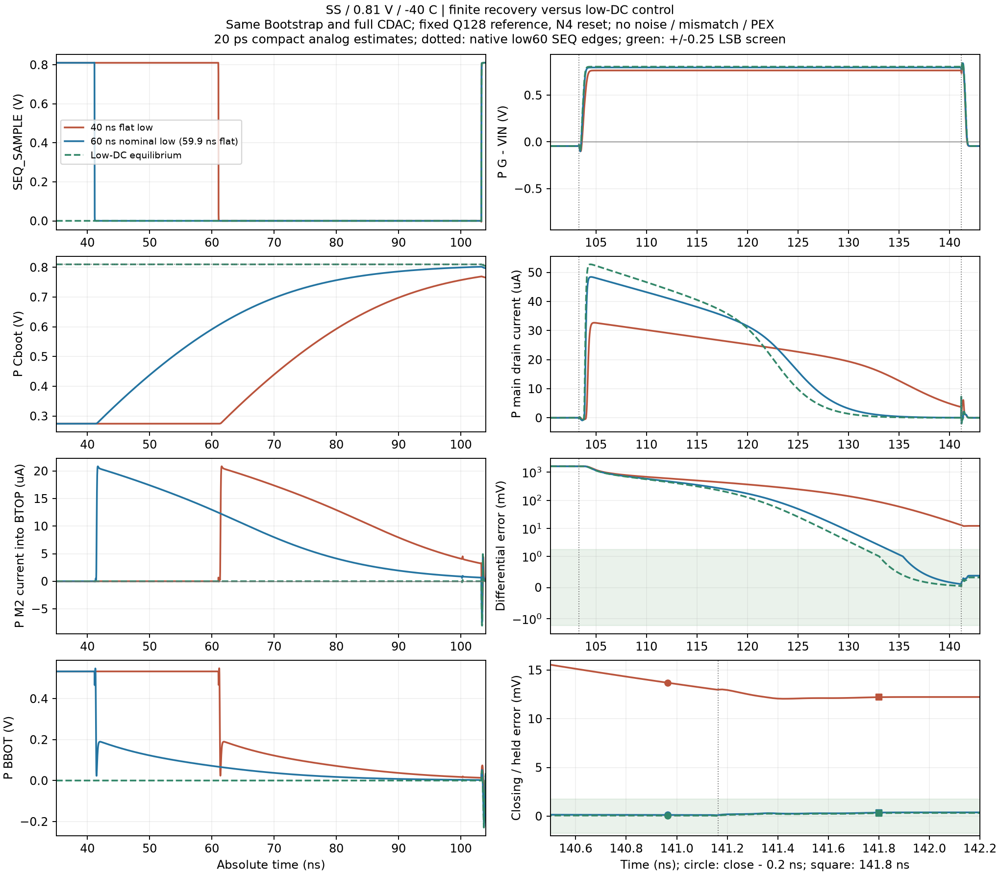

# 正常低相位的有限预充：SS 冷角结果

**名义 60 ns 低相位使本夹具的采样建立恢复正常。**它证明有限恢复可行，尚不能证明真实连续转换、启动或 POR 合格。

| 预充历史 | 实际 SEQ 低区间 (ns) | 获取窗口 (ns) | 关断前误差 (mV) | 关断后净变化 (mV) | 保持误差 (mV) |
| --- | ---: | ---: | ---: | ---: | ---: |
| 40 ns 低电平平台 | 42.2590 | 37.8410 | +13.69339 | −1.48250 | +12.21089 |
| **60 ns 名义低相位** | **62.1590** | **37.8410** | **+0.11967** | **+0.24233** | **+0.36200** |
| 低相位 DC 平衡 | 未定义 | 37.8376 | +0.05498 | +0.25108 | +0.30605 |

两组有限预充的已检查自然 DC 节点/支路状态完全相同；仅首次外部下降沿由 60.9–61 ns 提前至 41–41.1 ns。正式上升沿 101–101.1 ns、关闭沿 141–141.1 ns 保持不变。名义低相位按半电平交点计为 60 ns，完全低电平平台为 **59.9 ns**。实际 SEQ 低区间还包含时钟路径的不对称延迟，不能直接等同外部平台时间。

新例实际开启 **103.323692816 ns**、关闭 **141.164709913 ns**。关断前取关闭前 0.2 ns，保持取固定 141.8 ns；误差均为顶板差分减未拟合的输入源差分。关断后净变化包含继续建立、注入和耦合，不能单独视为沟道电荷注入。既有 ±0.25 LSB 诊断线为 ±1.7578125 mV，是共享误差筛查线。

左列从上到下为实际 SEQ、P 侧 Cboot、M2 向 BTOP 的电流、BBOT；右列为获取期间 G−VIN、主开关总漏电流、差分建立误差、关断附近放大。圆点为关断前测量，方点为保持测量；绿色带为 ±0.25 LSB。模拟曲线来自 20 ps 紧凑数据，开启/关闭由原生时间点计算。

| P 侧证据 | 40 ns 平台 | 60 ns 名义低相位 | DC 平衡 |
| --- | ---: | ---: | ---: |
| 100 ns Cboot (V) | 0.75710 | **0.79951** | 0.81000 |
| 100 ns M2 补充电流 (µA) | 4.09838 | **0.86537** | 约 0 |
| 100 ns M8 向地电流 (µA) | 4.09785 | **0.86527** | 约 0 |
| 开启前 10 ps Cboot (V) | 0.76931 | **0.80204** | 0.81000 |
| 110 ns G−VIN (V) | 0.76413 | **0.79632** | 0.80414 |
| 110 ns 两只主开关漏电流之和 (µA) | 30.19395 | **43.20589** | 46.63697 |
| 关断前 TOPP (mV)，目标 45 | 58.70946 | **45.09627** | 45.02774 |

预充时 M2 向 BTOP 补充电荷，M8 拉低 BBOT。60 ns 名义低相位在输入翻转前已更接近平衡，所需补充电流降至约 0.865 µA；正式获取时保留了更高泵压。110 ns 的 CTRL 在三例均约 46–47 mV、G−VIN 均为正，说明差别来自导通后的驱动/建立能力，而非一例完全未开。上述电流包含动态电荷且瞬时 VDS 不同，**不能据此换算 Ron 比值**。新例关断前主开关电流仅约 0.04075 µA，而 40 ns 例仍约 3.87751 µA，也支持后者尚未建立。

测试边界：SS MOS、0.81 V、−40°C、TT 无源；原有 2 µm 总宽主开关、两路 Bootstrap、完整 CDAC、最终参考级和实际采样时钟路径；参考固定 Q128、N4 比较器复位。输入差分 +0.81→−0.81 V 在 100.2–100.3 ns 翻转；输入/参考各 50 Ω、参考各 4 pF；理想外部电源/时钟，无噪声、失配、PEX。该例没有完整转换产生的前史。

三组冻结输入、全部收集文件 SHA 和无 skipped 记录均已独立核对；新例收集 16 文件、13,883,806 字节。原生日志为 Spectre 21.1.0.509、X CX、4 线程，温度 −40°C，零错误、7 warnings / 12 notices；有效 reltol=1e−7、vabstol=10 nV、iabstol=100 fA、maxstep=10 ps、gear2only。现有 warning 为全局端口声明、旧 AHDL 环境项及 PDK 重复缩放作用域提示，保留原日志。

已从原生应力导出独立重算每组 **237 MOS × 6 = 1422** 条端压记录（581 个独立节点对），三组均零超限；这是既有 0.99/1.98 V 诊断筛查，不等于寿命可靠性认证。新例原生 22,802 点；本地只逐组读取约 14 MB 收集数据，未读取大型原始 PSF。旧 cold_results/ 与 normal_period/ 散列在审核前后完全一致。

下一轮最小建议：复用本夹具和正常低相位，仅把**固定 Q128 参考边界**替换为上一转换末状态到采样复位的真实边界历史，N4 继续复位，其余输入、尺寸和正式时钟不变。边界由 reference/control 模块的原生事件和独立状态 oracle 提供，先检查其来源、工况与相位；当前收集的 FF 边界不直接跨角重放到 SS，待父任务确认合适来源后再准备。这样先验证参考切换对恢复的影响，再加入比较器活动；不急于加宽 Mmain，也不再用更长 DC 预充代替真实历史。最短预充时间仍未确定。

数据：[results.json](results.json)；脚本：[review_normal_period_results.py](../review_normal_period_results.py)。审阅过程无远端操作、电路修改或提交。本审阅未另启仿真；low60cold 为父任务本轮新增并统一运行的案例。
