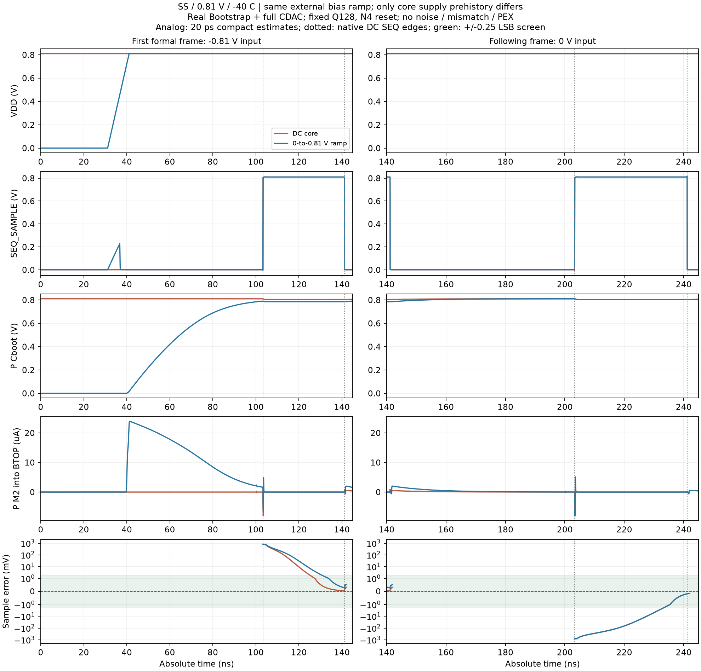
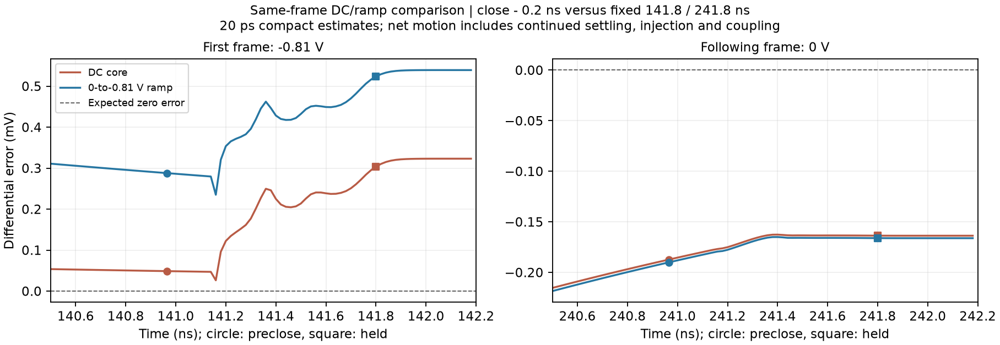
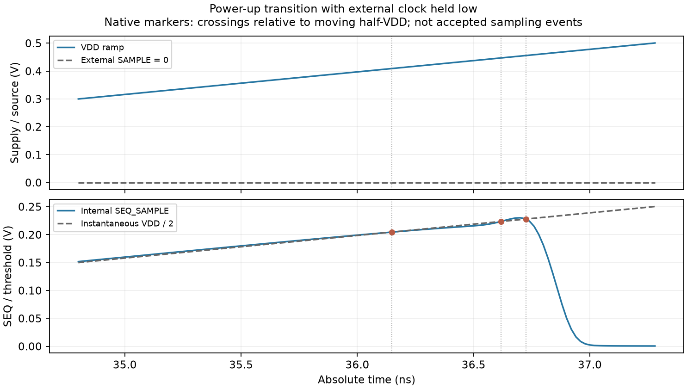

# SS 冷角：DC 已上电与从零爬升的双帧对照

本次有限爬升条件下，两帧均形成了可测量的正式采样窗口，保持误差小于既有 ±0.25 LSB 诊断线。**这提供了启动过程的实测证据，不等于 POR 或首帧有效性已经合格。**供电爬升期间，内部 SEQ 仍经过模拟中间电平。

两例只改变核心 VDD 前史：DC 对照从 t=0 已为 0.81 V；爬升例在 31.1–41.1 ns 从 0 升至 0.81 V。两例输入、参考和 Q128 外部边界命令采用相同斜坡，外部 SAMPLE 保持低至 101 ns。正式 101/141、201/241 ns 边沿和 MOS 均未改变。该斜坡与外部等待是已接受的**测试台假设**，不是电路中已有的电源检测、POR 或首帧有效逻辑。

| 帧 / 输入差分 | 核心电源前史 | 实际 SEQ 开启→关闭 (ns) | 关断前误差 (mV) | 关断净变化 (mV) | 固定保持点误差 (mV) |
| --- | --- | --- | ---: | ---: | ---: |
| 首帧 / −0.81 V | DC 已上电 | 103.3271→141.1647 | +0.048685 | +0.254795 | +0.303479 |
| 首帧 / −0.81 V | 从零爬升 | 103.3251→141.1647 | **+0.287818** | +0.235724 | **+0.523542** |
| 第二帧 / 0 V | DC 已上电 | 203.3237→241.1646 | −0.187385 | +0.023682 | −0.163703 |
| 第二帧 / 0 V | 从零爬升 | 203.3237→241.1646 | −0.190135 | +0.024002 | −0.166134 |

按**同一帧、同一输入**比较，爬升例首帧关断前误差比 DC 高 **0.239133 mV**，保持误差高 **0.220062 mV**；第二帧保持误差仅差 **−0.002430 mV**。首帧与第二帧输入不同，不能把它们在同一例中的误差变化全部解释为启动改善。

实际获取窗口：首帧 DC / 爬升为 37.837578 / 37.839641 ns，第二帧均约 37.840904 ns。首帧开启的原生插值差约 2.065 ps，关闭数值近似一致；外部窗口未被缩短。

左列为首次正式采样，右列包括首次保持后的恢复和第二次采样。从上到下为 VDD、SEQ、P 侧 Cboot、M2 向 BTOP 的电流、差分误差。误差只画正式获取到保持附近，不把未采样时输入翻转形成的差异记成 ADC 输出误差。绿色为共享 ±1.7578125 mV 诊断线，虚线零值为理想误差基准。

关断前测量点固定为各自实际关闭前 0.2 ns；保持点为 **141.8 / 241.8 ns**，均确认在关闭之后。圆点为关断前、方点为保持点。误差对比未拟合的输入源，在名义接口关闭沿 141.05 / 241.05 ns 取目标；两段输入保持不变，当前输入基准给出相同结果。净变化包含继续建立、馈通、注入和耦合，不是单独测得的沟道电荷注入。

首帧额外关断前误差主要体现在 N 顶板：DC / 爬升的 N 顶板相对 0.855 V 分别为 **−0.048284 / −0.272969 mV**，P 顶板相对 0.045 V 为 +0.000401 / +0.014849 mV。不能把旧 low40cold 中主要发生在 P 侧的大建立误差直接套用于此例。

| P 侧 Cboot 取样时刻 | DC 对照 (V) | 爬升例 (V) |
| --- | ---: | ---: |
| t=0，自然 DC | 0.809999987 | 约 0 |
| 41.11 ns，电源到位后 | 0.810000044 | **0.017098755** |
| 100.99 ns，正式源开启前 | 0.810000334 | **0.786027841** |
| 200.99 ns，第二次正式源开启前 | 0.809959636 | **0.809823540** |

DC 对照的 Cboot 在 t=0 就已预充，不能据它的首帧结果认定从零启动成功。爬升例在 VDD 到位时 Cboot 仍仅约 17 mV，随后自然充电；100.99 ns 的 M2 / M8 电流约 **1.93840 / 1.93816 µA**，200.99 ns 降至约 **0.01478 / 0.01477 µA**。110 ns 获取期间 P 侧 G−VIN 为 DC / 爬升 **0.804161 / 0.784695 V**，两例主开关都已导通。

这支持“有限上电历史留下不同泵压与储能状态”的解释。VDD 前史同时改变 Bootstrap、CDAC 初态和上电中间电平，现有对照没有单独隔离 Cboot 的独立贡献；动态漏电流也不能直接换算 Ron。开启前 10 ps 的快节点快照仅为 20 ps 波形插值，判断恢复优先用 100.99 / 200.99 ns 与获取期间的取样点。

爬升例在 **36.1491 ns（下降）、36.6171 ns（上升）、36.7256 ns（下降）** 出现 SEQ 相对瞬时半 VDD 的交越，此时外部 SAMPLE 为 0。VDD 分别仅约 **0.4090 / 0.4469 / 0.4557 V**，低于 0.81 V 的有效工作范围。SEQ 在半 VDD 附近经过模拟中间态，不能把三个交越当作三个有效时钟脉冲，也不能据此宣布 0.81 V 正常工作发生错误。它说明外部时钟低不等于上电全过程内部 SEQ 被强制钳低；何时允许接收内部事件和首个有效帧，仍需明确。DC 对照在 101 ns 前没有 SEQ 交越。

| 原生端压组最大值 | DC 对照 (V) | 爬升例 (V) | 本次诊断上限 (V) |
| --- | ---: | ---: | ---: |
| 核心时钟 / 负载 | 0.884949 | 0.884598 | 0.99 |
| 核心参考最终驱动 | 0.810153 | 0.810068 | 0.99 |
| Bootstrap | 1.660504 | 1.641035 | 1.98 |
| 参考开关 | 0.912941 | 0.912933 | 1.98 |
| 复位中的比较器 | 0.892698 | 0.856098 | 1.98 |

两例均独立复算 **237 MOS × 6 = 1422 条端压记录，581 个独立节点对，零超限**。全部原生点参与应力和事件分析：DC / 爬升为 35,509 / 37,152 个原生点，模拟波形为 9,523 / 9,550 个 20 ps 选点。全部收集与冻结输入 SHA、gzip/原始波形 SHA、原生零错误日志均已核对；无 CMI 代码，仍保留 SFE-1131、SFE-2453、VACOMP-2435。无 CMI 和该端压筛查都不是寿命可靠性或启动资格结论。

边界为 SS MOS、0.81 V、−40°C、TT 无源；真实 Bootstrap 与完整 CDAC、参考固定 Q128、N4 复位，输入/参考各 50 Ω、参考各 4 pF，理想外部电源/时钟，无噪声、失配、PEX。没有真实 SAR 转换或参考切换历史，也没有输出 ADC 码字。工作电源合约仍是 0.81–0.99 V，此次两例只覆盖其中一个点。

两例各回收 18 文件、16,540,954 / 17,932,208 字节，均低于 32 MiB 且无 skipped。远端仿真峰值最高约 300.59 MiB、分析约 135.38 MiB；本地标量审核约 55 MiB，比较绘图峰值 **112.97 MiB**。只逐块核对和逐组 memmap，未读取大型原始 PSF。解压副本单独忽略于 Git，原始回收和远端波形保持只读。原生能量仍只覆盖 0–100 / 100–200 ns，不能据它报告第二帧完整功耗。

数据：[完整对照 JSON](results.json)、[DC 测量](../dc_core/measurements.json)、[DC 证据](../dc_core/evidence.json)、[爬升测量](../ramp_core/measurements.json)、[爬升证据](../ramp_core/evidence.json)。两例由父任务本轮新增并统一运行；本审阅只处理已回收结果，没有新增试验、改电路或提交。
