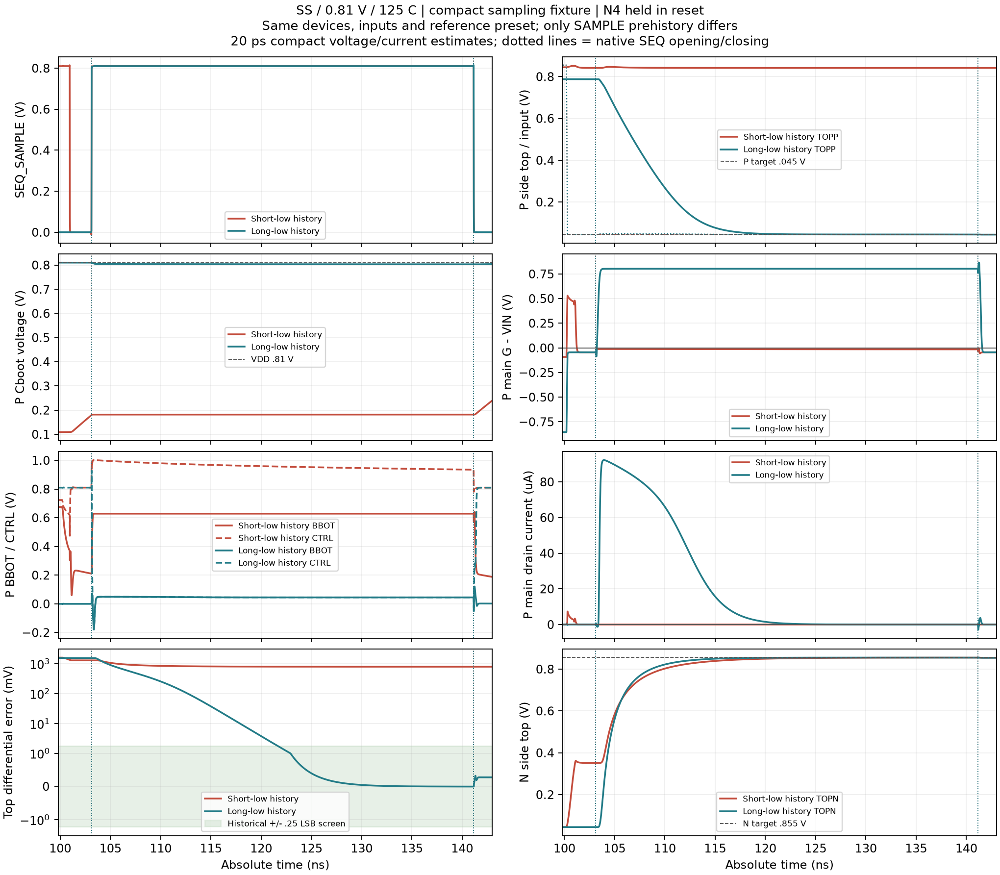

# SS热角短低相/长低相：异常定位

结论：目前没有发现两组共同的供电、端口或负载提取缺陷。短组的约797mV
误差来自P侧在正式获取期间没有恢复正常自举导通；长低相组使用同一电路和
正式时序，正常建立并得到约0.279mV保持误差。这是本诊断台的历史敏感性
证据，不将797mV外推成原整机正常周期误差，也不作POR资格结论。

测试：SS/0.81V/125°C，原0/0.9V参考、每侧50Ω输入、每参考轨50Ω/4pF，
完整CDAC，N4比较器复位，固定Q128参考状态；无瞬态噪声、失配或PEX。
两组仅SAMPLE前史不同，原生实际reltol=1e-7/maxstep10ps；电压和电流图是
20ps紧凑插值，交越和端压峰值检查使用全部原生点。

| 观测项 | 短低相 | 长低相 |
| --- | ---: | ---: |
| 实际SEQ_SAMPLE开启/ns | 103.110617 | 103.117169 |
| 实际关闭/ns | 141.154911 | 141.155154 |
| 实际正常高相窗口/ns | 38.044294 | 38.037984 |
| 可观测的此前低相/ns | 2.155711 | 无下降沿；DC即为低相 |
| 关断前差分误差/mV | **+796.7090** | +0.000895 |
| 141.8ns顶板差分/mV，目标−810 | −12.5465 | −809.7210 |
| 141.8ns源端参考误差/mV | **+797.4535** | **+0.27903** |
| 141.8ns底板相对固定preset最大残差/mV | 0.02789 | 0.04582 |
| 全MOS端压超限项/1422 | 0 | 0 |

## 供电与提取核对

两组冻结的fixture/test/mapping/stream与打包SHA一致，XF参数顺序与子电路
端口逐项相同，未使用ic/nodeset。Bootstrap Vin接原实际输入、VOUT接完整
CDAC顶板，VDD!和0端口对应同名全局源。原生日志SFE-2453是全局节点同时
作为子电路端口的提示；波形实际VDD=0.81V。两侧实际输入在保持点约为
0.045/0.855V，长组两侧都能正确建立，短组N侧也接近0.855V。

参考底板均保持固定preset，误差远小于1mV；CMP_RESET固定0V，两组使用
相同N4输入和复位负载。因此现有证据不支持把约797mV归因于共享参考错轨、
全局电源未接上或顶板/输入端口错接。仍不宣称被切除的负载完全动态等效。

## 误差形成路径

1. 短组从高相DC开始，P侧Cboot仅约0.109V，高输入侧G约0.763V。输入随后
   按原PWL在100.2–100.3ns由高变低，P顶板还保留约0.845V。
2. 外部100ps低平台经真实时钟链后，SEQ实际低相约2.156ns；它没有被完全
   滤掉。低相结束前10ps，P侧Cboot约0.179V，显著低于长组约0.810V。
   这是该前史下观察到的充电不足，不是已提取的通用最小预充时间。
3. 正式获取期间，短组P侧BBOT停在约0.6285V，CTRL约0.98V（110ns），
   G仅约0.032V。M4C的CLKS−BBOT约0.181V；这与控制节点无法正常拉低、
   M4未把有效升压送到G的解释一致。尚未独立提取M4C阈值，不据此给出
   硬阈值结论。
4. 110ns时短组P主管G−VIN约−0.013V，两只主管漏端电流合计约1.6pA；
   长组G−VIN约+0.803V，主管漏端电流合计约66.0µA。长组将P顶板放电到
   0.045V，短组则保持在约0.842V。这里主要是主管未导通，尚无继续加W的依据。
5. 关断前已经有796.709mV误差，关断至141.8ns只再净变化约0.745mV。
   因此巨大误差形成于获取期，不能算作关断注入。

长组DC时Cboot已自然达到约0.810V；它不是“从零电荷起充101ns”的实验。
两组高相窗口只差约6.31ps，保持前输入均为静态，无法解释近0.8V差异。
两组实际开启/关闭沿并非逐点相同，报告保留其差别。

## 下一步修改方向

先把低相恢复时间纳入启动协议。后续应从相同高相DC初态出发，只提前低相
开始时刻形成有限持续时间对照，保持101ns上升和141ns关闭；观察自然恢复
的Cboot、BBOT、CTRL和G，而非直接强制电荷。由此确定有效低相需要多久，
再判断正常空闲段是否足够。只有有限正常低相仍不足时，才单变量考虑M2/M8
预充/放电支路。当前不改Mmain、供电或外部采样关闭沿。

该结果支持物理预充历史是主要原因，但有限两组不能完全分离初始顶板电荷
等历史差异；真实电源爬升和最短启动要求仍未知。全端压筛查通过不等于
原ADC功能、精度或可靠性闭合。

## 证据与资源

输入与结果均冻结在两组managed目录。两组回收文件共27,685,639bytes，
均为精简证据；未读原始约1GB PSF。父及本任务先前有界读取已核对回执
全部SHA，本轮使用内存映射查看紧凑数据。JSON数值见results.json，生成
脚本为../review_results.py；结果图已目视检查。未修改冻结输入、未远端操作、
未新增仿真或提交。
