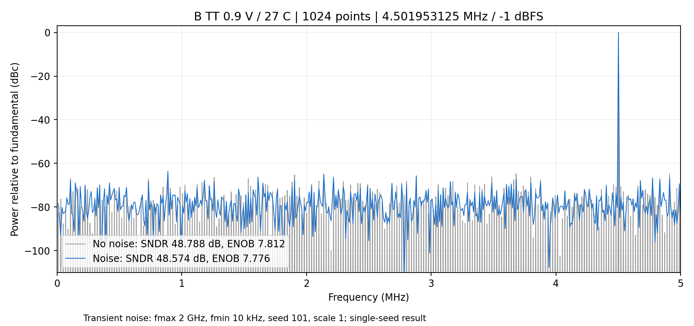

# B版含噪声FFT

2026-10-31 — B1024 noisyFFT collected: simulation exit0 in148183.08s (41.16h), managed analysis exit0 in301s.9 hashchecked small files495975bytes, no raw.1032 native/observer codes match, all-frame protocol valid. SNDR48.57407865dB/SFDR63.62885045dBc/ENOB7.77642503; versus no-noise delta -0.21399872dB/-1.13894120dB/-0.03554796bit.53/1024 codes change by1LSB, not wrongcode verdict. Maxconversion29.477963ns vs29.435806; close edge maxdelta0.164516ps. Core+ref86.521735uW gridestimate. NumPy independent FFT agrees within1e-8dB. Retain CMI2751..2755, numerical warnings and SPECTRE555 (1.87MB swap observed, performance warning). Single-seed/bandwidth and low-frequency limits remain. Spectrum plotted at verification/sar8_noise/fft_final/spectrum_comparison.png. No simulations/circuit/OA/automation/policy changes, cleanup, commit/push.

